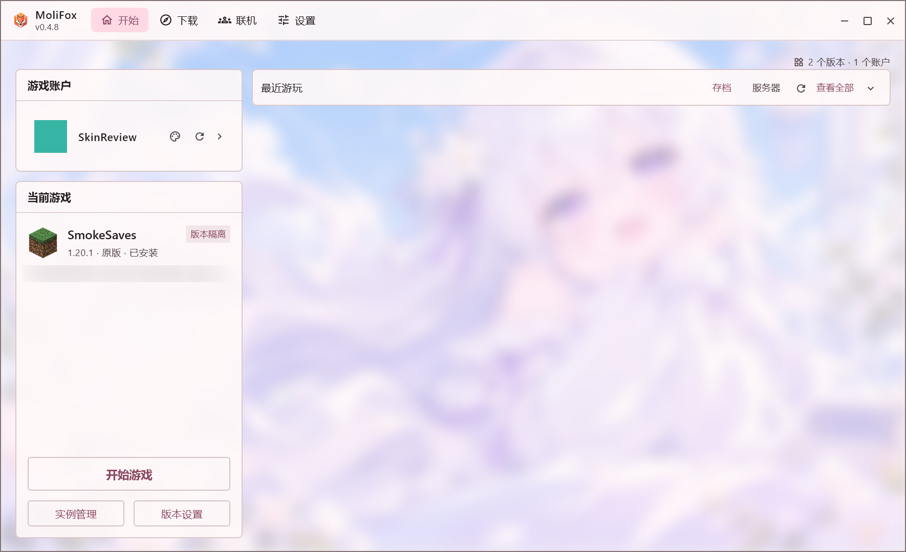

# MoliFox Launcher

  
  
  

[下载启动器](https://github.com/Tinmoli/MoliFox/releases) · [更新记录](https://github.com/Tinmoli/MoliFox/releases) · [问题反馈](https://github.com/Tinmoli/MoliFox/issues)

## 简介

MoliFox 是使用 Kotlin 与 Compose Multiplatform 开发的开源 Minecraft Java 版启动器，支持 Windows、Linux 与 macOS 的 x64/ARM64。它将游戏实例、模组与整合包管理、账户和多人联机集中在同一套界面中，并提供主题、背景和字体等个性化设置。

当前版本为 **0.5.0**。可用版本及更新内容以发布页为准。

## 支持系统

| 系统 | 架构 | 支持情况 |
| --- | --- | --- |
| Windows 10/11 | x64 | 启动器与游戏均支持；没有可用 Java 时自动下载 Java 17。 |
| Windows 10/11 | ARM64 | 启动器支持，没有可用 Java 时自动下载 Java 21；游戏需所选版本和加载器提供 ARM64 原生库。 |
| Linux | x64 | 启动器与游戏均支持；没有可用 Java 时自动下载 Java 17。 |
| Linux | ARM64 | 启动器支持；游戏需 ARM64 原生库，暂不支持视频背景。 |
| macOS 11+ | x64 / ARM64 | 仅提供 `MoliFox.jar`，需自装 Java 17+，尚未在 Mac 真机验证。 |

视频背景（MP4 等）依赖对应平台的 MPV 解码库：Windows x64/ARM64、Linux x64 与 macOS 按需下载运行库；Linux ARM64 暂无可用构建，不支持视频背景。

> **小暮绾偷偷在这里说几句话**
>
> 这个启动器的大部分内容，是我借助 AI 一点点写出来的。有些地方可能还没做好，也可能藏着 Bug，不要骂我，呜呜呜……如果发现了问题，欢迎[提交 Issue](https://github.com/Tinmoli/MoliFox/issues) 告诉我，我会慢慢改好的。谢谢你愿意使用 MoliFox 啦！

## 主要功能

| 功能 | 说明 |
| --- | --- |
| 游戏与实例 | 安装游戏和模组加载器，为不同实例设置 Java、内存与启动参数。 |
| 模组与资源 | 搜索、安装和更新模组、资源包与光影；安装前检查依赖和同名文件。 |
| 内容安装 | 游戏运行中也可安装模组、资源包与光影；数据包需退出游戏后再操作。 |
| 整合包 | 导入、导出多种格式的整合包，按需打包资源与配置。 |
| 存档与投影 | 备份、恢复和导入存档，整理实例中的投影文件。 |
| 账户与皮肤 | 使用微软或离线账户，管理游戏皮肤。 |
| 多人联机 | 创建或加入房间，查看房间与玩家状态。 |
| 外观设置 | 自定义主题、背景与字体；支持 GIF 动图与 MP4 等视频背景。 |

## 许可与声明

MoliFox 采用 [GPL-3.0-only](LICENSE) 发布，署名与附加条款见 [NOTICE](assets/legal/NOTICE)。第三方组件保留各自许可，见 [第三方声明](assets/legal/THIRD_PARTY.md)。使用条款见 [用户协议](assets/legal/AGREEMENT.md)。

Minecraft 是 Mojang 的商标。本项目与 Mojang、Microsoft 没有关联。
