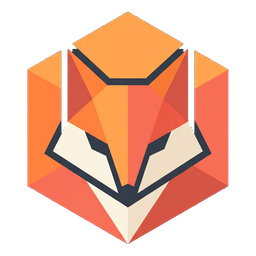

# MoliFox Launcher

  
  
  

[下载启动器](https://github.com/Tinmoli/MoliFox/releases) · [更新记录](https://github.com/Tinmoli/MoliFox/releases) · [问题反馈](https://github.com/Tinmoli/MoliFox/issues)

## 简介

MoliFox 是使用 Kotlin 与 Compose Multiplatform 开发的开源 Minecraft Java 版启动器，支持 Windows 和 Linux x86_64。它将游戏实例、模组与整合包管理、账户和多人联机集中在同一套界面中，并提供主题、背景和字体等个性化设置。

当前源码版本为 **0.4.3**。可用版本及更新内容以发布页为准。

> **小暮绾偷偷在这里说几句话**
>
> 这个启动器的大部分内容，是我借助 AI 一点点写出来的。有些地方可能还没做好，也可能藏着 Bug，不要骂我，呜呜呜……如果发现了问题，欢迎[提交 Issue](https://github.com/Tinmoli/MoliFox/issues) 告诉我，我会慢慢改好的。谢谢你愿意使用 MoliFox 啦！

## 功能

| 功能 | 说明 |
| --- | --- |
| 实例管理 | 管理多个游戏目录，设置版本隔离、Java 和启动参数。 |
| 游戏安装 | 安装原版及多种模组加载器，管理已有游戏版本。 |
| 内容管理 | 搜索、下载和管理模组、资源包与光影。 |
| 整合包与备份 | 导入、导出多种格式的整合包，备份实例。 |
| 账户与联机 | 微软账户、离线账户、皮肤管理和多人联机。 |
| 界面个性化 | 调整主题、背景、字体及界面外观。 |

## 下载

在 [GitHub Releases](https://github.com/Tinmoli/MoliFox/releases) 选择对应平台的附件：

| 平台 | 架构 | 文件 |
| --- | --- | --- |
| Windows | x86_64 | `MoliFox-<版本>-windows-x86_64.exe` |
| Linux | x86_64 | `MoliFox-<版本>-linux-x86_64.run` |

- **首次运行**：需要联网准备界面依赖；之后可离线打开启动器。缺少可用 Java 时，按提示准备运行环境。
- **数据位置**：默认保存在程序旁的 `MoliFox/`；主动添加的外部游戏目录直接使用原文件。
- **平台范围**：当前提供 Windows、Linux 桌面版，暂不提供 macOS、Android 和 ARM 安装包。

## 反馈与贡献

欢迎通过 [Issue](https://github.com/Tinmoli/MoliFox/issues) 反馈问题或提出建议，也欢迎提交 Pull Request。

报告问题时，请附上启动器版本、操作系统、复现步骤，以及相关日志或截图，方便定位。

## 许可与声明

MoliFox 采用 [GPL-3.0-only](LICENSE) 发布，署名与附加条款见 [NOTICE](assets/legal/NOTICE)。第三方组件保留各自许可，见 [第三方声明](assets/legal/THIRD_PARTY.md)。使用条款见 [用户协议](assets/legal/AGREEMENT.md)。

Minecraft 是 Mojang 的商标。本项目与 Mojang、Microsoft 没有关联。
